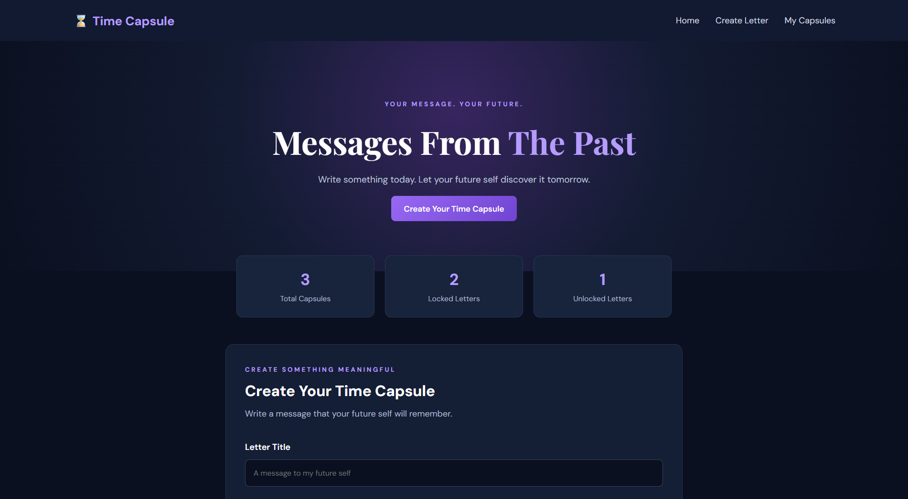
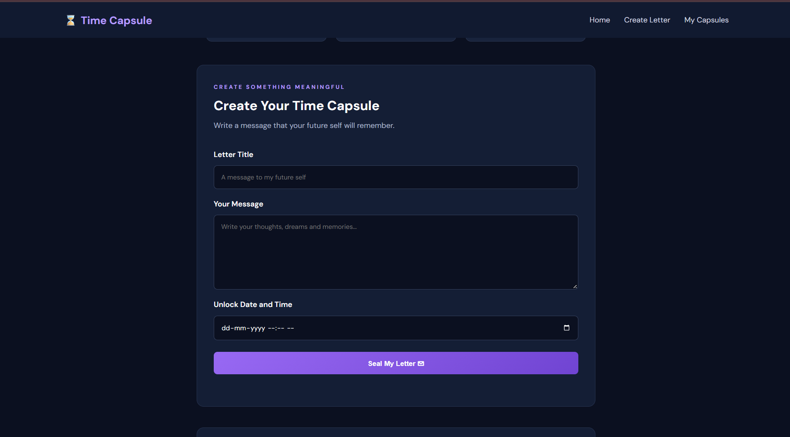
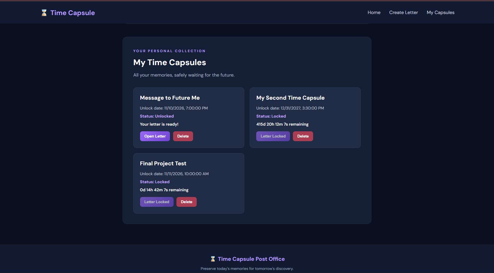
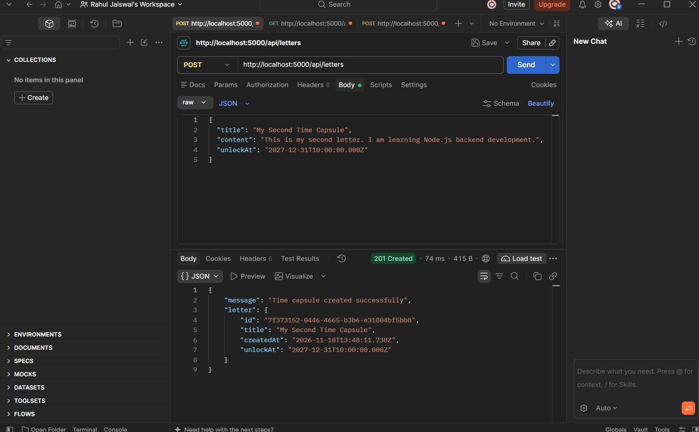
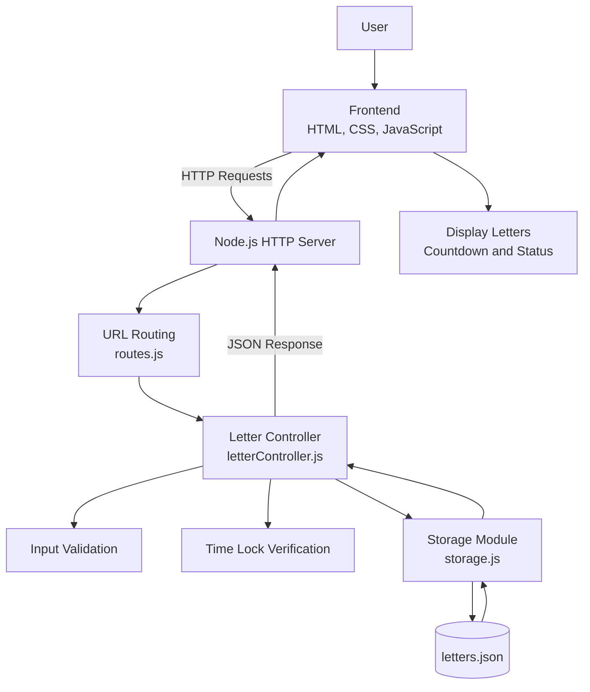

## 🌐 Live Demo

**Live Website:** [Time Capsule Post Office](https://time-capsule-post-office.onrender.com)

Explore the application online and experience scheduled time capsules.
# Time Capsule Post Office

A web-based application developed using Node.js that allows users to write digital letters and schedule them to unlock at a future date and time.

## Features

- Create digital time capsules.
- Schedule future unlock dates.
- Live countdown timer.
- Secure time-based letter access.
- View all saved capsules.
- Delete existing capsules.
- JSON-based data storage.
- REST-style HTTP APIs.
- Responsive user interface.

## Technologies Used

- Node.js
- JavaScript
- HTML5
- CSS3
- JSON
- HTTP Module
- File System Module
- URL Module
- Crypto Module
- Postman

## Project Structure

Time-Capsule-Post-Office/
- backend/
- frontend/
- data/
- package.json
- README.md

## Installation

1. Clone the repository.

2. Open the project directory.

3. Start the server:

   npm.cmd run dev

4. Open your browser:

   http://localhost:5000

## API Endpoints

| Method | Endpoint | Description |
|---|---|---|
| POST | /api/letters | Create a letter |
| GET | /api/letters | Get all letters |
| GET | /api/letters/:id | Open a letter |
| DELETE | /api/letters/:id | Delete a letter |

## Project Objective

To develop a digital time capsule platform that preserves personal messages and makes them accessible only after a specified future date.

## Developer

Rahul Jaiswal

Master of Computer Applications (MCA)

Presidency University, Bengaluru

## Application Screenshots

### 1. Homepage

### 2. Create Time Capsule

### 3. My Time Capsules

### 4. API Testing

## System Architecture

The Time Capsule Post Office follows a client-server architecture. The frontend communicates with the Node.js HTTP server through HTTP requests. The backend routes requests to the letter controller, which validates input, checks unlock times, and interacts with JSON-based file storage.

### Architecture Components

| Component | Responsibility |
|---|---|
| Frontend | User interface and countdown display |
| HTTP Server | Handles incoming HTTP requests |
| Routes | Directs requests to the correct controller |
| Letter Controller | Creates, retrieves, and deletes letters |
| Validation | Checks title, content, and unlock date |
| Time Lock Verification | Prevents access before the unlock date |
| Storage Module | Reads and writes letter data |
| JSON File | Stores capsule records |
